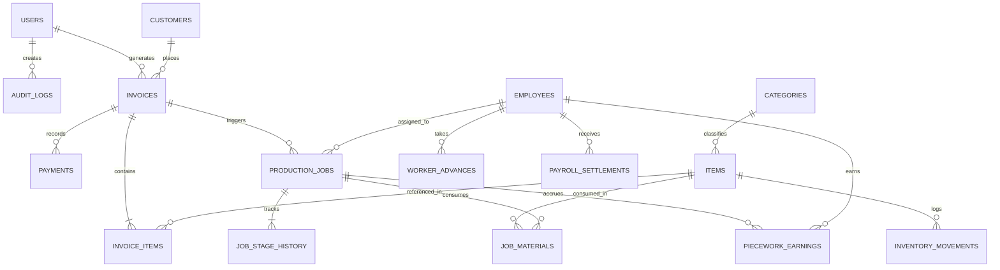

# Database Design & EER Model Specification
**System:** WoodFlow — Wimalasiri Furniture, Kottawa  
**Database Engine:** PostgreSQL 16  
**Module:** CS304.3 Advanced Database Management Systems

---

## 1. High-Level Entity-Relationship (ER) Architecture

The schema is partitioned into 4 cohesive functional domains around a shared core:



---

## 2. Table Schemas & Relational Specifications

### Domain 0: Shared Core & Security
```sql
-- 1. Users & Authentication
CREATE TABLE users (
    user_id SERIAL PRIMARY KEY,
    username VARCHAR(50) UNIQUE NOT NULL,
    password_hash VARCHAR(255) NOT NULL,
    full_name VARCHAR(100) NOT NULL,
    role VARCHAR(20) NOT NULL CHECK (role IN ('OWNER', 'CASHIER', 'WORKSHOP_SUPERVISOR')),
    is_active BOOLEAN DEFAULT TRUE,
    created_at TIMESTAMP WITH TIME ZONE DEFAULT CURRENT_TIMESTAMP
);

-- 2. Audit Trail
CREATE TABLE audit_logs (
    log_id BIGSERIAL PRIMARY KEY,
    user_id INT REFERENCES users(user_id) ON DELETE SET NULL,
    action VARCHAR(50) NOT NULL,
    entity_name VARCHAR(50) NOT NULL,
    entity_id INT NOT NULL,
    old_values JSONB,
    new_values JSONB,
    ip_address VARCHAR(45),
    created_at TIMESTAMP WITH TIME ZONE DEFAULT CURRENT_TIMESTAMP
);
```

### Domain 1: Customers, Sales & Invoicing (Module 1)
```sql
-- 3. Customers
CREATE TABLE customers (
    customer_id SERIAL PRIMARY KEY,
    full_name VARCHAR(100) NOT NULL,
    phone_number VARCHAR(20) UNIQUE NOT NULL,
    address TEXT,
    whatsapp_number VARCHAR(20),
    created_at TIMESTAMP WITH TIME ZONE DEFAULT CURRENT_TIMESTAMP
);

-- 4. Invoices
CREATE TABLE invoices (
    invoice_id SERIAL PRIMARY KEY,
    invoice_number VARCHAR(30) UNIQUE NOT NULL,
    customer_id INT NOT NULL REFERENCES customers(customer_id) ON DELETE RESTRICT,
    invoice_date DATE NOT NULL DEFAULT CURRENT_DATE,
    order_type VARCHAR(20) NOT NULL CHECK (order_type IN ('READY_MADE', 'CUSTOM_ORDER', 'MIXED')),
    subtotal DECIMAL(12,2) NOT NULL CHECK (subtotal >= 0),
    discount_amount DECIMAL(12,2) DEFAULT 0.00 CHECK (discount_amount >= 0),
    total_amount DECIMAL(12,2) NOT NULL CHECK (total_amount >= 0),
    paid_amount DECIMAL(12,2) DEFAULT 0.00 CHECK (paid_amount >= 0),
    balance_amount DECIMAL(12,2) GENERATED ALWAYS AS (total_amount - paid_amount) STORED,
    payment_status VARCHAR(20) DEFAULT 'UNPAID' CHECK (payment_status IN ('UNPAID', 'PARTIALLY_PAID', 'PAID')),
    created_by INT REFERENCES users(user_id),
    created_at TIMESTAMP WITH TIME ZONE DEFAULT CURRENT_TIMESTAMP
);

-- 5. Invoice Line Items
CREATE TABLE invoice_items (
    item_id SERIAL PRIMARY KEY,
    invoice_id INT NOT NULL REFERENCES invoices(invoice_id) ON DELETE CASCADE,
    product_id INT REFERENCES items(item_id) ON DELETE SET NULL, -- Nullable for bespoke custom items
    item_description TEXT NOT NULL,
    is_custom_build BOOLEAN DEFAULT FALSE,
    quantity INT NOT NULL CHECK (quantity > 0),
    unit_price DECIMAL(12,2) NOT NULL CHECK (unit_price >= 0),
    line_total DECIMAL(12,2) GENERATED ALWAYS AS (quantity * unit_price) STORED
);

-- 6. Payments Ledger
CREATE TABLE payments (
    payment_id SERIAL PRIMARY KEY,
    invoice_id INT NOT NULL REFERENCES invoices(invoice_id) ON DELETE RESTRICT,
    payment_date TIMESTAMP WITH TIME ZONE DEFAULT CURRENT_TIMESTAMP,
    payment_type VARCHAR(20) NOT NULL CHECK (payment_type IN ('ADVANCE_DEPOSIT', 'INTERMEDIATE_PROGRESS', 'FINAL_SETTLEMENT')),
    payment_method VARCHAR(20) NOT NULL CHECK (payment_method IN ('CASH', 'BANK_TRANSFER', 'CARD')),
    amount DECIMAL(12,2) NOT NULL CHECK (amount > 0),
    reference_number VARCHAR(100),
    received_by INT REFERENCES users(user_id)
);
```

### Domain 2: Workshop Production & Stage Tracking (Module 2)
```sql
-- 7. Production Jobs
CREATE TABLE production_jobs (
    job_id SERIAL PRIMARY KEY,
    job_ticket_no VARCHAR(30) UNIQUE NOT NULL,
    invoice_id INT REFERENCES invoices(invoice_id) ON DELETE SET NULL, -- Decoupled: can exist independently
    customer_id INT REFERENCES customers(customer_id) ON DELETE RESTRICT,
    furniture_type VARCHAR(50) NOT NULL, -- e.g., 'King Size Teak Bed'
    specifications TEXT, -- Wood dimensions, varnish tone, fabric code
    current_stage VARCHAR(30) NOT NULL DEFAULT 'DESIGN_APPROVAL' 
        CHECK (current_stage IN (
            'DESIGN_APPROVAL', 
            'TIMBER_CUTTING_FRAMEWORK', 
            'CUSHIONING_UPHOLSTERY', 
            'SANDING_SPRAY_POLISHING', 
            'QUALITY_INSPECTION', 
            'DELIVERY'
        )),
    lead_craftsman_id INT REFERENCES employees(employee_id) ON DELETE SET NULL,
    target_delivery_date DATE,
    actual_delivery_date DATE,
    is_completed BOOLEAN DEFAULT FALSE,
    created_at TIMESTAMP WITH TIME ZONE DEFAULT CURRENT_TIMESTAMP
);

-- 8. Job Stage Progression History
CREATE TABLE job_stage_history (
    history_id SERIAL PRIMARY KEY,
    job_id INT NOT NULL REFERENCES production_jobs(job_id) ON DELETE CASCADE,
    stage_name VARCHAR(30) NOT NULL,
    entered_at TIMESTAMP WITH TIME ZONE DEFAULT CURRENT_TIMESTAMP,
    completed_at TIMESTAMP WITH TIME ZONE,
    inspected_by INT REFERENCES users(user_id),
    stage_notes TEXT
);

-- 9. Job Raw Material Consumption
CREATE TABLE job_material_allocations (
    allocation_id SERIAL PRIMARY KEY,
    job_id INT NOT NULL REFERENCES production_jobs(job_id) ON DELETE CASCADE,
    material_id INT NOT NULL REFERENCES items(item_id) ON DELETE RESTRICT,
    quantity_allocated DECIMAL(10,2) NOT NULL CHECK (quantity_allocated > 0),
    unit_cost_at_time DECIMAL(10,2) NOT NULL,
    allocated_at TIMESTAMP WITH TIME ZONE DEFAULT CURRENT_TIMESTAMP
);
```

### Domain 3: Dual-Channel Inventory (Module 3)
```sql
-- 10. Categories
CREATE TABLE categories (
    category_id SERIAL PRIMARY KEY,
    name VARCHAR(50) UNIQUE NOT NULL,
    description TEXT
);

-- 11. Unified Inventory Items (Finished vs Raw)
CREATE TABLE items (
    item_id SERIAL PRIMARY KEY,
    sku_code VARCHAR(30) UNIQUE NOT NULL,
    item_name VARCHAR(100) NOT NULL,
    item_type VARCHAR(25) NOT NULL CHECK (item_type IN ('FINISHED_FURNITURE', 'RAW_MATERIAL')),
    category_id INT REFERENCES categories(category_id) ON DELETE SET NULL,
    unit_of_measure VARCHAR(20) NOT NULL, -- 'UNITS', 'BOARD_FEET', 'METERS', 'LITERS'
    current_stock DECIMAL(10,2) NOT NULL DEFAULT 0.00 CHECK (current_stock >= 0),
    reorder_level DECIMAL(10,2) DEFAULT 5.00,
    cost_price DECIMAL(12,2) NOT NULL CHECK (cost_price >= 0),
    retail_selling_price DECIMAL(12,2) CHECK (retail_selling_price >= cost_price),
    is_active BOOLEAN DEFAULT TRUE,
    created_at TIMESTAMP WITH TIME ZONE DEFAULT CURRENT_TIMESTAMP
);

-- 12. Inventory Stock Movement Ledger
CREATE TABLE inventory_movements (
    movement_id BIGSERIAL PRIMARY KEY,
    item_id INT NOT NULL REFERENCES items(item_id) ON DELETE RESTRICT,
    movement_type VARCHAR(25) NOT NULL CHECK (movement_type IN ('PURCHASE_RECEIPT', 'SALE_DEDUCTION', 'WORKSHOP_ISSUANCE', 'RETURN_RESTOCK', 'DAMAGE_WRITE_OFF')),
    quantity DECIMAL(10,2) NOT NULL,
    stock_before DECIMAL(10,2) NOT NULL,
    stock_after DECIMAL(10,2) NOT NULL,
    reference_id VARCHAR(50), -- Invoice No or Job Ticket No
    performed_by INT REFERENCES users(user_id),
    created_at TIMESTAMP WITH TIME ZONE DEFAULT CURRENT_TIMESTAMP
);
```

### Domain 4: Workforce & Artisan Piecework Accounting (Module 4)
```sql
-- 13. Employees & Craftsmen
CREATE TABLE employees (
    employee_id SERIAL PRIMARY KEY,
    full_name VARCHAR(100) NOT NULL,
    nic_number VARCHAR(15) UNIQUE NOT NULL,
    phone_number VARCHAR(20) NOT NULL,
    employment_type VARCHAR(25) NOT NULL CHECK (employment_type IN ('MONTHLY_SALARIED', 'PIECEWORK_ONLY', 'HYBRID_SALARIED_PIECEWORK')),
    base_monthly_salary DECIMAL(10,2) DEFAULT 0.00,
    joined_date DATE DEFAULT CURRENT_DATE,
    is_active BOOLEAN DEFAULT TRUE
);

-- 14. Artisan Piecework Earnings (Tied to Specific Furniture Jobs)
CREATE TABLE piecework_earnings (
    earning_id SERIAL PRIMARY KEY,
    employee_id INT NOT NULL REFERENCES employees(employee_id) ON DELETE RESTRICT,
    job_id INT NOT NULL REFERENCES production_jobs(job_id) ON DELETE RESTRICT,
    agreed_labor_cost DECIMAL(10,2) NOT NULL CHECK (agreed_labor_cost > 0),
    stage_attributed VARCHAR(30), -- e.g., 'Carpentry Framework' or 'Polishing'
    is_approved BOOLEAN DEFAULT FALSE,
    approved_by INT REFERENCES users(user_id),
    created_at TIMESTAMP WITH TIME ZONE DEFAULT CURRENT_TIMESTAMP
);

-- 15. Worker Mid-Month Cash Advances
CREATE TABLE worker_advances (
    advance_id SERIAL PRIMARY KEY,
    employee_id INT NOT NULL REFERENCES employees(employee_id) ON DELETE RESTRICT,
    amount DECIMAL(10,2) NOT NULL CHECK (amount > 0),
    request_date DATE DEFAULT CURRENT_DATE,
    reason TEXT,
    is_settled BOOLEAN DEFAULT FALSE, -- Flips to TRUE when settled in payroll
    issued_by INT REFERENCES users(user_id)
);

-- 16. Monthly Payroll & Piecework Settlements
CREATE TABLE payroll_settlements (
    settlement_id SERIAL PRIMARY KEY,
    employee_id INT NOT NULL REFERENCES employees(employee_id) ON DELETE RESTRICT,
    settlement_period VARCHAR(7) NOT NULL, -- Format: 'YYYY-MM'
    base_salary DECIMAL(10,2) DEFAULT 0.00,
    total_piecework_earned DECIMAL(10,2) DEFAULT 0.00,
    total_advances_deducted DECIMAL(10,2) DEFAULT 0.00,
    net_payout DECIMAL(10,2) NOT NULL,
    settled_date TIMESTAMP WITH TIME ZONE DEFAULT CURRENT_TIMESTAMP,
    payment_method VARCHAR(20) DEFAULT 'CASH'
);
```

---

## 3. Advanced Database Concepts Implementation (ADBMS Grading Criteria)

### A. ACID Transaction: Atomic Invoice Creation & Advance Deposit
```sql
CREATE OR REPLACE PROCEDURE sp_create_order_with_deposit(
    p_customer_id INT,
    p_order_type VARCHAR,
    p_total_amount DECIMAL,
    p_deposit_amount DECIMAL,
    p_payment_method VARCHAR,
    p_created_by INT,
    OUT p_invoice_id INT,
    OUT p_invoice_number VARCHAR
)
LANGUAGE plpgsql
AS $$
BEGIN
    -- Check minimum 1/3 deposit rule for custom orders
    IF p_order_type IN ('CUSTOM_ORDER', 'MIXED') AND p_deposit_amount < (p_total_amount / 3.0) THEN
        RAISE EXCEPTION 'Deposit amount (Rs. %) must be at least 33.33%% of total price (Rs. %)', 
            p_deposit_amount, p_total_amount;
    END IF;

    -- Generate unique invoice number: INV-YYYYMMDD-XXXX
    p_invoice_number := 'INV-' || TO_CHAR(CURRENT_DATE, 'YYYYMMDD') || '-' || LPAD(FLOOR(RANDOM()*10000)::TEXT, 4, '0');

    -- Insert Invoice Header
    INSERT INTO invoices (
        invoice_number, customer_id, order_type, subtotal, 
        total_amount, paid_amount, payment_status, created_by
    ) VALUES (
        p_invoice_number, p_customer_id, p_order_type, p_total_amount, 
        p_total_amount, p_deposit_amount, 
        CASE 
            WHEN p_deposit_amount >= p_total_amount THEN 'PAID'
            WHEN p_deposit_amount > 0 THEN 'PARTIALLY_PAID'
            ELSE 'UNPAID'
        END,
        p_created_by
    ) RETURNING invoice_id INTO p_invoice_id;

    -- If deposit was received, record in payment ledger
    IF p_deposit_amount > 0 THEN
        INSERT INTO payments (
            invoice_id, payment_type, payment_method, amount, received_by
        ) VALUES (
            p_invoice_id, 'ADVANCE_DEPOSIT', p_payment_method, p_deposit_amount, p_created_by
        );
    END IF;
END;
$$;
```

### B. Trigger: Automated Stock Decrement & Movement Logging
```sql
CREATE OR REPLACE FUNCTION fn_audit_stock_movement()
RETURNS TRIGGER AS $$
DECLARE
    v_stock_before DECIMAL(10,2);
    v_stock_after DECIMAL(10,2);
BEGIN
    v_stock_before := OLD.current_stock;
    v_stock_after := NEW.current_stock;

    IF v_stock_before <> v_stock_after THEN
        INSERT INTO inventory_movements (
            item_id, movement_type, quantity, stock_before, stock_after, reference_id
        ) VALUES (
            NEW.item_id,
            CASE 
                WHEN v_stock_after > v_stock_before THEN 'PURCHASE_RECEIPT'
                ELSE 'WORKSHOP_ISSUANCE'
            END,
            ABS(v_stock_after - v_stock_before),
            v_stock_before,
            v_stock_after,
            'AUTO_TRIGGER'
        );
    END IF;
    RETURN NEW;
END;
$$ LANGUAGE plpgsql;

CREATE TRIGGER trg_stock_audit
AFTER UPDATE OF current_stock ON items
FOR EACH ROW
EXECUTE FUNCTION fn_audit_stock_movement();
```

### C. Analytical Views
```sql
-- 1. Outstanding Customer Debtor Balances
CREATE OR REPLACE VIEW vw_customer_outstanding_balances AS
SELECT 
    c.customer_id,
    c.full_name,
    c.phone_number,
    c.whatsapp_number,
    COUNT(i.invoice_id) AS total_orders,
    SUM(i.total_amount) AS total_billed,
    SUM(i.paid_amount) AS total_paid,
    SUM(i.balance_amount) AS outstanding_balance
FROM customers c
JOIN invoices i ON c.customer_id = i.customer_id
WHERE i.balance_amount > 0
GROUP BY c.customer_id, c.full_name, c.phone_number, c.whatsapp_number;

-- 2. Workshop Job Status & Lead Time View
CREATE OR REPLACE VIEW vw_workshop_active_pipeline AS
SELECT 
    pj.job_id,
    pj.job_ticket_no,
    pj.furniture_type,
    pj.current_stage,
    e.full_name AS craftsman_name,
    pj.target_delivery_date,
    (pj.target_delivery_date - CURRENT_DATE) AS days_remaining,
    COALESCE(SUM(pe.agreed_labor_cost), 0.00) AS total_labor_allocated
FROM production_jobs pj
LEFT JOIN employees e ON pj.lead_craftsman_id = e.employee_id
LEFT JOIN piecework_earnings pe ON pj.job_id = pe.job_id
WHERE pj.is_completed = FALSE
GROUP BY pj.job_id, pj.job_ticket_no, pj.furniture_type, pj.current_stage, e.full_name, pj.target_delivery_date;
```

### D. Composite Indexes for Query Optimization
```sql
-- Fast invoice lookups by customer and payment status
CREATE INDEX idx_invoices_customer_status ON invoices (customer_id, payment_status);

-- Rapid filtering of active workshop jobs by stage
CREATE INDEX idx_production_stage ON production_jobs (current_stage, target_delivery_date);

-- Fast stock inventory searches by item type and SKU
CREATE INDEX idx_items_type_sku ON items (item_type, sku_code);
```
